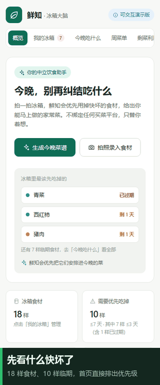

# 鲜知 · 冰箱大脑

> **不做菜谱搜索，做临期倒计时**：先算冰箱里哪样快坏了，再决定今晚吃什么。



一个**纯前端、零后端、零外部依赖**的饮食管理 PWA。9 个视图、31 种食材、30 道菜谱全部内联在 `data.js`，**双击 `fridge-app/index.html` 就能跑**，断网可用。数据只存在你自己浏览器的 `localStorage`：没有账号、没有上传、没有埋点回传。

| 你想做什么 | 最快路径 |
|---|---|
| **先体验一下** | 在线演示：`https://xianzhi-fridge.app.workbuddy.host/?sharecode=SKSE4SNXI2` |
| 想离线自己跑 | `Code → Download ZIP`，解压后只进 `fridge-app/`，双击 `index.html` |
| 想知道需要哪些文件 | 见下文「想体验，需要下载哪些文件」 |
| 想看它怎么被证伪 | 直接读「验证状态」与 `fridge-app/m4-report.js` |
| 想吐槽 / 提想法 | 见 [FEEDBACK.md](FEEDBACK.md)，或点仓库 `Issues → New issue` |

> 在线演示链接**请整条复制**（含 `?sharecode=...`），用普通浏览器窗口打开；无痕模式或清过 Cookie 会 403。授权 Cookie 有效期 30 天，实测至 2026-12-09，不影响 14 天验证。

---

## 为什么值得点进来

大多数菜谱应用让你先想「今天想吃什么」，再去搜做法。这里反过来：**先给冰箱里的食材排一个临期倒计时**，快坏的东西优先进入今晚的候选，再按库存、忌口、口味与历史评分给 30 道菜排序。做饭时自动扣最早到期批次；剩菜单独成盒、不重复扣库存，还能反推改造方案和「凑一锅」。

更不一样的是，它**把「怎么证伪自己」也写进了代码**：内置 20 人 × 14 天打卡、连续日期 CSV 导出、以及自动出 `GO / NO-GO / INCOMPLETE` 结论的判定脚本。样本不足时脚本不会凑数，护栏命中忌口/过敏时直接叫停。加上 242 项主自检与 33 项真实 Chrome 回归——这是一个**准备好被真实使用检验**的原型，而不是一个宣称「已验证」的 Demo。

**但 M4 真实验证目前尚未执行，README 如实标注：没有任何真实使用数据，也没有结论。**

---

## 验证状态（请先读这一段）

| 项 | 状态 |
|---|---|
| 功能与文档 | 已完成（PRD、竞品分析、M4 开跑包齐全） |
| 自动化质量保障 | 已完成（242 项主自检 + 33 项真实 Chrome 回归） |
| 第 1–3 天包装与体验检查 | **已完成（2026-11-09）**：在线 Demo 11/11 资源 200、手机端 390/360 两档 9 视图无横向溢出与 0 控制台错误 → [检查报告](docs/第1-3天_体验检查报告.md) |
| **M4 冷启动验证（20 人 × 14 天）** | **未执行** |

代码里的打卡埋点、CSV 导出、`m4-report.js` 判定脚本都是**为这 14 天准备的工具链**。目前没有任何真实使用数据，因此**没有 GO / NO-GO 结论**。请勿把「功能已完成」理解为「已验证有人每天用」。

判定口径见 `AI饮食管家_产品需求文档_PRD.md` §11 / §13：7 日留存 ≥25% 且推荐采纳率 ≥20% 才继续投入；样本不足时脚本输出 `INCOMPLETE`，不会强行下结论。执行手册见 `AI饮食管家_M4开跑包.md` 与 `docs/` 下的分阶段清单。

---

## 功能

- **今晚吃什么**：按临期、库存、忌口、口味、历史评分推荐菜谱；临期食材全覆盖面板，推荐理由全部可见
- **我的冰箱**：批次与保质期管理，做饭时优先消耗最早到期批次
- **周菜单**：7 天规划、自动采购清单、营养概览、临期锚定
- **营养**：每道菜的估算热量与三大营养素、每日记录、月度回顾
- **剩菜利用**（C4）：剩菜盒、改造方案排序、凑一锅、熟食 2 天安全护栏
- **统计**：下厨次数、临期救回数、估算节省金额
- **数据备份**（B2）：一键导出 / 导入全量 JSON，结构校验 + 二次确认覆盖，换设备不断档
- **PWA**：离线可用、可添加到主屏、network-first 缓存策略
- **M4 验证套件**：每日轻打卡、匿名编号、连续日期 CSV 导出、自动判定报告
- **M5 真实识别适配层**：代码就绪但**默认关闭**，需自行填写端点与凭据启用

手机上顶部 9 个导航是**横向可滑动**的，首屏只露出前 5 个，左右滑一下就能看到后面几个。

## 想体验，需要下载哪些文件

**一个文件都不用下载**——上面的在线链接就能完整体验。若要本地 / 离线跑，只要 `fridge-app/` 这一个文件夹（15 个文件、约 305 KB）：

| 用途 | 文件 |
|---|---|
| **最小可运行**（双击即用） | `index.html`、`styles.css`、`data.js`、`engine.js`、`ai-adapter.js`、`app.js` |
| **完整 PWA**（建议再多拿 5 个） | `manifest.json`、`sw.js`、`icon-192.png`、`icon-512.png`、`icon-maskable-512.png` |
| 体验用不到 | `verify.js`、`verify-proxy.js`、`m4-report.js`、`ai-proxy.js`、仓库根目录 9 个文档/脚本 |

`ai-adapter.js` 虽默认不联网，但被 `index.html` 直接加载，**不要漏掉**；缺图标/manifest 不影响功能，只会在控制台留几条 404。

```bash
# 只想取 fridge-app/ 文件夹（GitHub 网页不支持单目录下载）
git clone --depth 1 --filter=blob:none --sparse https://github.com/ZZoo711/ai-fridge-butler.git
cd ai-fridge-butler && git sparse-checkout set fridge-app
```

双击 `index.html` 功能全可用，但 Service Worker 在 `file://` 下不生效；想要离线与「添加到主屏」，请在 `fridge-app/` 里执行 `python -m http.server 8000` 后打开 `http://localhost:8000`。

## 反馈

见 [FEEDBACK.md](FEEDBACK.md)。仓库 `Issues → New issue` 里有三个现成表单：**体验反馈 / Bug 报告 / 功能建议**，都带隐私确认项，不需要你注册任何外部服务。

> 正在参加 M4 的 20 位参与者**请勿用 Issue 反馈日常体验**：验证期只走 App 内打卡与第 14 天 CSV，避免组织者的引导污染留存与采纳率（见 `AI饮食管家_M4开跑包.md` §2）。

## 目录结构

```
.
├── fridge-app/                   # 网页版全部源码（15 个文件，纯静态）
│   ├── index.html / styles.css
│   ├── data.js / engine.js / app.js
│   ├── ai-adapter.js / ai-proxy.js
│   ├── sw.js / manifest.json / icon-*.png
│   ├── verify.js / verify-proxy.js / m4-report.js
├── docs/                         # 演示素材与 25 天路线图执行材料
│   ├── demo-30s.gif / social-preview.png
│   ├── 第1-3天_体验检查报告.md
│   ├── 第4-7天_招募启动清单.md
│   ├── 第8-21天_每日执行清单.md
│   └── 第22-25天_分析与迭代模板.md
├── .github/ISSUE_TEMPLATE/       # 三类反馈表单
├── tools/                        # 可复跑的手机端检查与演示素材生成脚本
├── e2e-regression.js             # 真实 Chrome 端到端回归（零依赖，本机跑）
├── make-icons.js                 # PWA 图标生成脚本
├── AI饮食管家_产品需求文档_PRD.md
├── AI饮食管家_M4开跑包.md
├── AI饮食管家_竞品与市场分析报告.md
├── FEEDBACK.md
├── LICENSE
└── README.md
```

分层约定：`data.js` 数据层 → `engine.js` 纯函数层（可单测）→ `app.js` 状态与 DOM 层。使用经典 `<script>` 顺序加载，因此直接以 `file://` 打开也能运行。

## 本地运行

```bash
# 方式一：直接双击 fridge-app/index.html（功能可用；PWA / Service Worker 不生效）
# 方式二：起本地服务（推荐，SW 在 localhost 下生效）
cd fridge-app
python -m http.server 8000
# 浏览器打开 http://localhost:8000
```

## 质量验证

```bash
cd fridge-app
node verify.js                 # 242 项：纯函数 + 结构 + DOM 桩冒烟
node verify-proxy.js           # 10 项：本地 AI 代理链路
node m4-report.js --selftest   # 17 项：CSV 判定口径

cd ..
node e2e-regression.js         # 33 项：真实 Chrome 回归，需本机安装 Chrome
node tools/capture-demo.js --app=./fridge-app --out=./.check-output   # 手机端 390/360 检查 + 截图
```

`e2e-regression.js` 自动探测 Chrome，也可用 `CHROME_PATH` 或 `--chrome=<路径>` 指定；支持 `--scene=a|b|all`、`--keep`。临时探针与 profile 自动清理。

M4 回收 CSV 后出报告：

```bash
cd fridge-app
node m4-report.js ../m4-csv/*.csv --out ../AI饮食管家_M4冷启动验证报告.md
```

## 隐私与数据

- 所有业务数据只在浏览器 `localStorage`，**没有服务端、没有账号、没有自动上传**。
- 备份导出的是**明文 JSON**（含偏好、做饭与营养记录、剩菜、打卡记录），请自行保管；导入为覆盖式恢复，操作不可撤销。
- M4 的 CSV 必须由用户**手动点击导出**，脚本不会主动发送。
- 真实多模态识别默认关闭；启用后密钥只存在本机 `localStorage` 或本地代理的环境变量里，不写日志、不回显。
- 忌口/过敏护栏在推荐层硬排除，但营养值为估算、熟食 2 天为统一经验值，详见 PRD §17.3。

## 路线图

**25 天总体路线图**：先验证 → 再优化 → 再传播 → 最后扩张。分阶段执行材料在 `docs/`：

1. 第 1–3 天：项目包装与体验检查（已完成）
2. 第 4–7 天：招募首批 20 名真实用户、分配匿名编号、启动 14 天测试
3. 第 8–21 天：真实使用验证，轻量打卡、记录采纳/临期消耗/放弃原因，**不随意改测试指标**
4. 第 22–25 天：分析与产品迭代，出 GO / NO-GO 后再决定要不要优化与传播

之后：M5 真实识别（填凭据启用）→ M6 微信小程序 → M7 商业化。其中 **M7 的前置条件是 M4 数据达标**。剩余 backlog 里 C5 云端同步（登录 + 同步层）优先级最高，其余 C6 分享卡、C1 一键下单按既定顺序延后。详见 PRD §14 与 `AI饮食管家_M4开跑包.md` §9。

## 许可证

[MIT](LICENSE)
